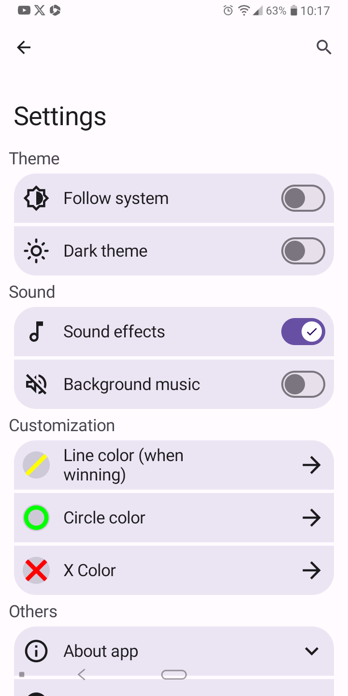
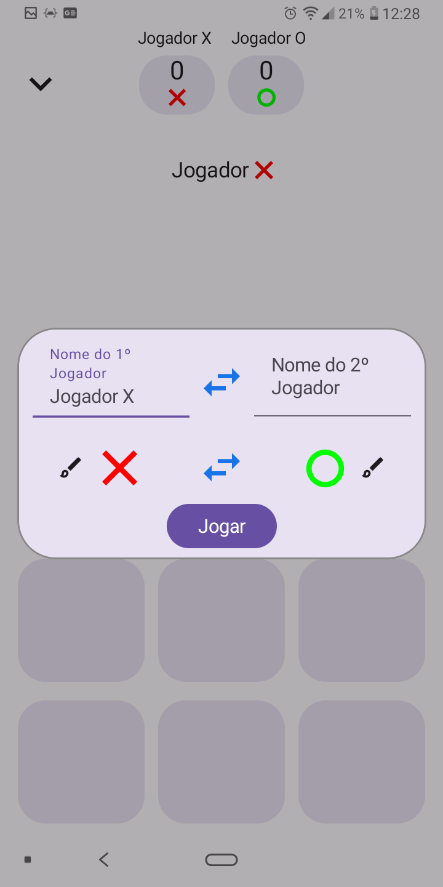
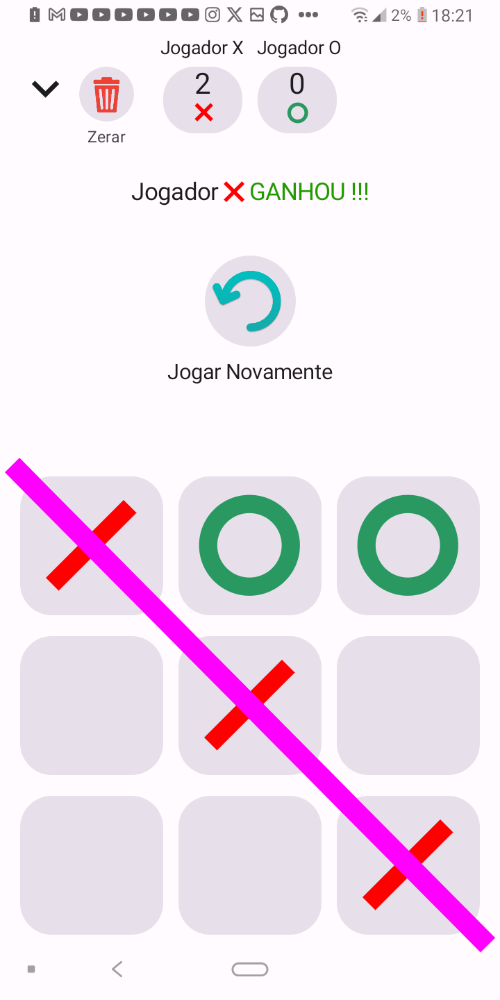
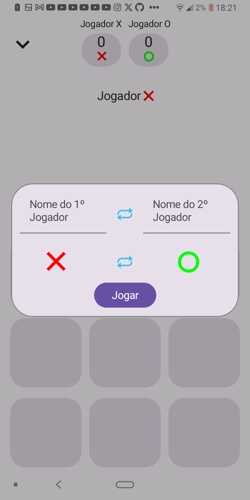

# Tic-Tac-Toe-You
A classic tic-tac-toe game made with material you and others new android technologies

# Features:
*The game have all basic features that you expect in a tic tac toe game and the following below:*
- The UI is constructed with material you components
- Dynamic Colors support
- Beautiful card to add name and select you icon "X" or "O"
- Sound Effects when click in cards, when has a win ou things like it
- Background Music
- Line when there is a winner
- Versus CPU Mode

# Employed technologies:
- Room database
- Dependency Injection w/ Dagger Hilt
- Clean Arquiteture
- MVVM patterns
- Jetpack Compose
- Media3 Library
- Kotlin 100%
- Reative Programming w/ Kotlin Flows

# Game Screenshots:

# Incompletes/Bugged Features
- The data is not being saved in the database

# Follow me on Instagram
[Instagram](https://www.instagram.com/rafael_mourana/)