<!--suppress ALL -->

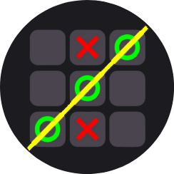

<h1 align="center">Tic Tac Toe You</h1>

<h3 align="center">A classic tic-tac-toe game made with material you and others new android technologies</h1>

# Features:
*The game have all basic features that you expect in a tic tac toe game and the following below:*
- The UI is constructed with material you components
- Dynamic Colors support
- Beautiful card to add name and select you icon "X" or "O"
- Sound effects & background music
- Line when there is a winner
- Versus CPU Mode

# Game Screenshots:

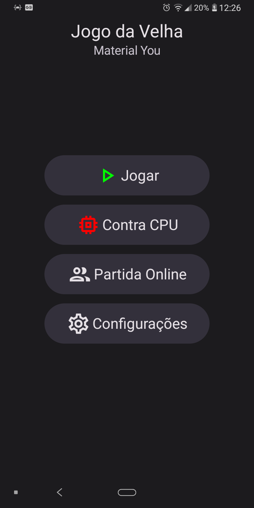
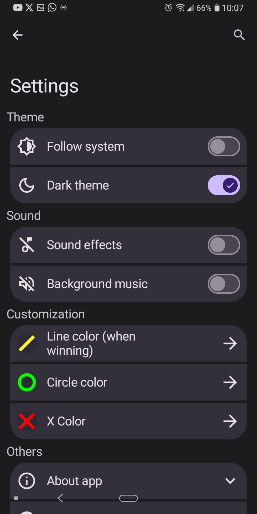
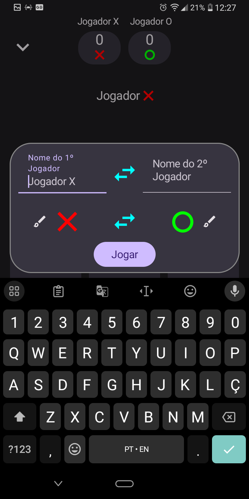

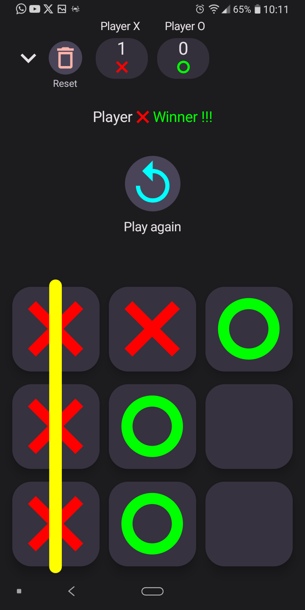
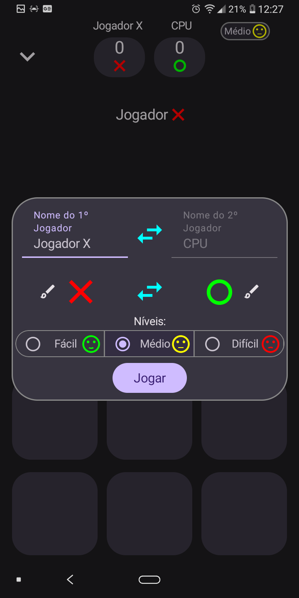
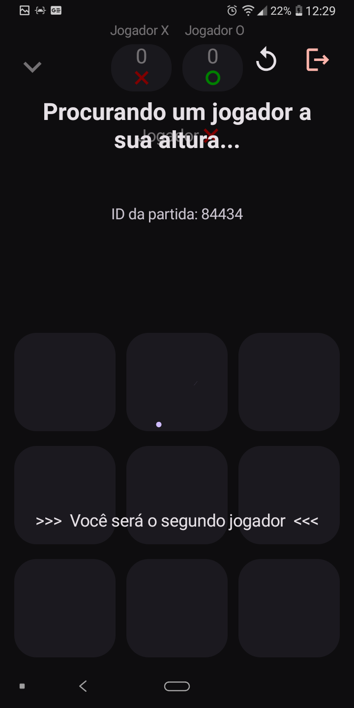

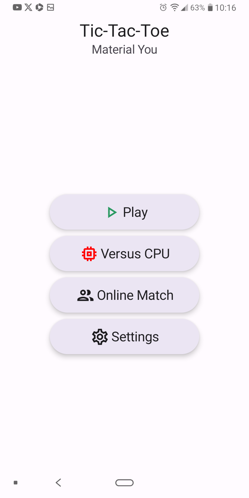

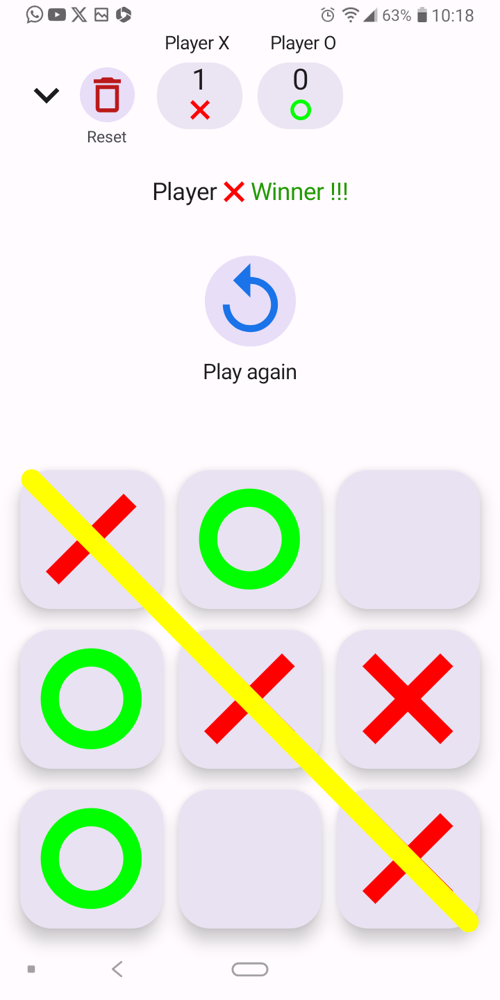
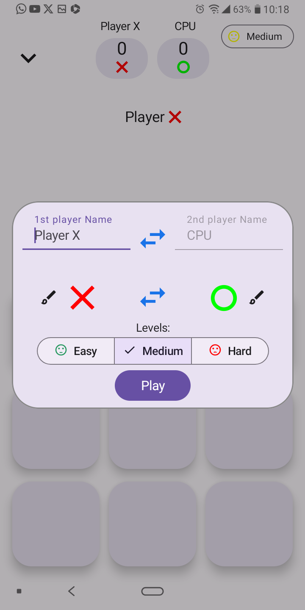
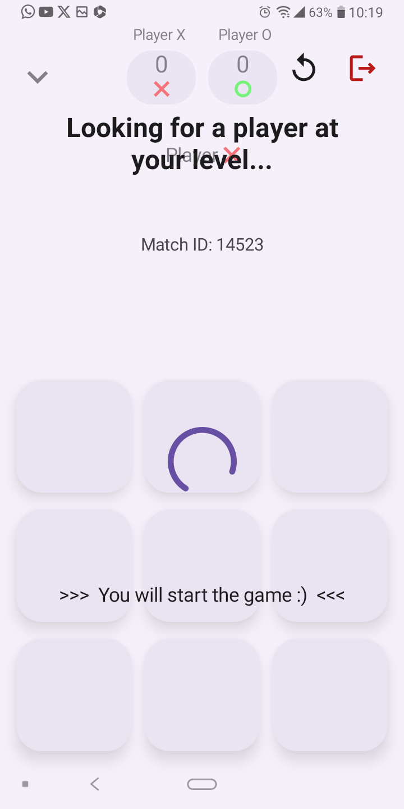

# Employed technologies:
- [Room database](https://developer.android.com/jetpack/androidx/releases/room?hl=en) for persistent data storage
- [Koin](https://insert-koin.io/) for dependency injection
- [Clean Architecture](https://medium.com/simform-engineering/clean-architecture-in-android-12d61c4f5318) and [MVVM](https://www.google.com/amp/s/www.geeksforgeeks.org/mvvm-model-view-viewmodel-architecture-pattern-in-android/amp/) patterns
- [Jetpack Compose](https://developer.android.com/jetpack/compose?hl=en) for UI development kit
- [Media3](https://developer.android.com/jetpack/androidx/releases/media3?hl=en) for sound related features
- [Kotlin](https://kotlinlang.org/) language
- [Coroutines](https://kotlinlang.org/docs/coroutines-guide.html) and [Flows](https://developer.android.com/kotlin/flow) for asynchronous and reactive programming
- [Androidx SplashScreen](https://developer.android.com/reference/kotlin/androidx/core/splashscreen/SplashScreen) for splash screen implementation
- [Navigation Compose](https://developer.android.com/jetpack/compose/navigation?hl=en) for navigation between screens
- [Retrofit](https://square.github.io/retrofit/) and [OkHttp3](https://square.github.io/okhttp/) for network operations
- [Spotless](https://github.com/diffplug/spotless) for Kotlin code linting
- [Coil Compose](https://coil-kt.github.io/coil/compose/) for async image loading
- [Material Motion](https://fornewid.github.io/material-motion-compose/) for screen transition animation
- [App Search](https://developer.android.com/jetpack/androidx/releases/appsearch?hl=en) for in app search
- [Androidx Libraries](https://developer.android.com/jetpack/androidx?hl=en) for core and base features for Android
- [Moko permissions](https://github.com/icerockdev/moko-permissions) for permission handling in
  Kotlin multiplatform

# Follow me on Instagram
[Instagram](https://www.instagram.com/rafael_mourana/)
